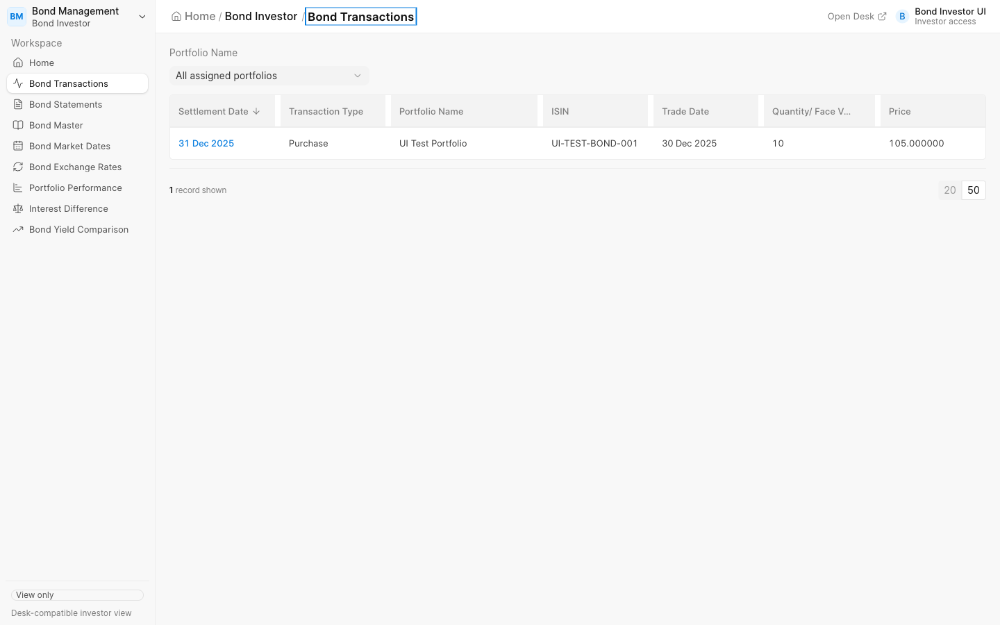
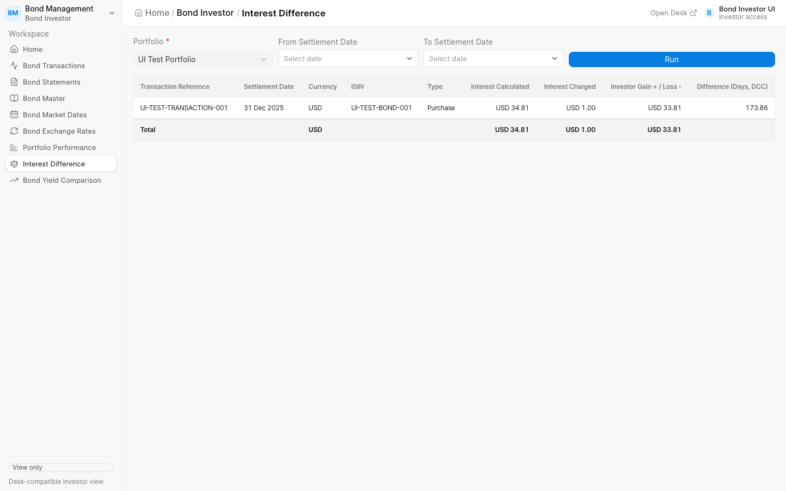
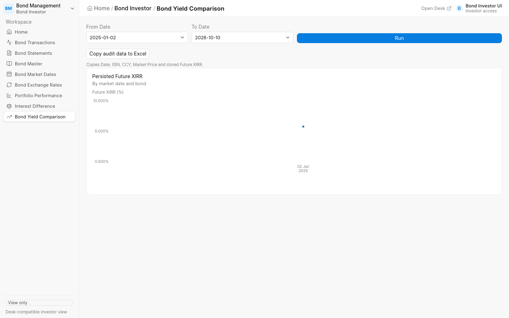

# Bond Management

Bond Management is a Frappe Framework v16 application for managing fixed-income portfolios from bond setup through transaction capture, statement reconciliation, market data, and performance reporting.

It provides two complementary experiences:

- An internal Desk workspace for maintaining bond, portfolio, transaction, statement, market-data, and exchange-rate records.
- A responsive, read-only investor application at `/bond-investor` for permission-scoped portfolio data and reports.

Financial calculations and permissions are enforced on the server. Uploaded statements and transaction documents remain private.

## What the app does

| Area                 | Capabilities                                                                                                                                                                              | Main records or reports                                           |
| -------------------- | ----------------------------------------------------------------------------------------------------------------------------------------------------------------------------------------- | ----------------------------------------------------------------- |
| Reference data       | Define bonds, coupon schedules, principal repayments, day-count conventions, currencies, withholding tax, and quantity-change rules.                                                      | Bond Master, Bond Coupon Schedule, Bond Principal Schedule        |
| Portfolio operations | Store portfolio and account details and associate users with the portfolios they are allowed to see.                                                                                      | Bond Portfolio                                                    |
| Transactions         | Record purchases and sales manually or extract transaction data from private PDF attachments. Validate dates, prices, accrued interest, commissions, and ledger consistency.              | Bond Transaction                                                  |
| Statements           | Extract statement identity, holdings, prices, and exchange rates from private PDFs; reconcile statement quantities with calculated portfolio positions; generate a reconciliation report. | Bond Statement, Bond Statement Details                            |
| Market data          | Maintain dated market prices, principal factors, weighted repayment dates, future XIRR values, and yield-curve data.                                                                      | Bond Market Date, Bond Market Prices                              |
| Exchange rates       | Store statement-sourced and manually maintained currency rates, including reverse rates, with per-statement provenance. Equal rates are shared; conflicting rates reject the save.        | Bond Exchange Rate, Bond Exchange Rate Source                     |
| Analytics            | Review portfolio value, proceeds, gains, past and future XIRR, historical stored bond yields, and settlement interest differences.                                                        | Portfolio Performance, Interest Difference, Bond Yield Comparison |

The normal operating flow is:

```text
Bond and portfolio setup
            ↓
Transaction and statement capture
            ↓
Reconciliation and market-data maintenance
            ↓
Portfolio performance and yield analysis
            ↓
Permission-scoped investor view
```

## Investor application

The investor application is a Vue 3, TypeScript, and Frappe UI frontend served from the same Frappe session. It is intentionally read-only: users can browse and analyze data but cannot create, edit, delete, or upload financial records from this surface.

Available investor surfaces:

- Bond Transactions: sortable, filterable transaction lists and read-only details.
- Bond Statements: statement history, reconciliation status, holdings, and permitted document downloads.
- Bond Master: bond terms and generated coupon/principal schedules.
- Bond Market Dates: dated market prices and yield-curve details.
- Bond Exchange Rates: dated currency-rate history.
- Portfolio Performance: valuation-date portfolio values, gains, native/reporting-currency XIRR, and copyable cash flows.
- Interest Difference: transaction-level comparison of calculated and charged interest, investor gain or loss, and equivalent difference days with currency totals.
- Bond Yield Comparison: date-range comparison of persisted Future XIRR values with currency-aware chart series and audit-data export.

Access is controlled by the existing Frappe roles and portfolio permissions:

- `Bond Investor Read Only` users see only portfolios assigned through Frappe User Permission records.
- `Bond Management Manager` users and `Administrator` can use the investor application for support and review while retaining internal Desk access.
- Other users and guests are denied access to the investor application and its APIs.

### Screenshots

These screenshots use synthetic records from the local `bond-management-test.localhost`; they do not contain production or real investor data.







## Internal Desk workspace

Internal users work from the **Bond Investor** workspace at `/desk/bond-investor`. It contains shortcuts to the operational records and reports:

- Bond Transactions
- Bond Statements
- Bond Master
- Bond Market Dates
- Bond Exchange Rates
- Portfolio Performance
- Interest Difference
- Bond Yield Comparison

The Desk workflow remains the source for financial mutations, attachment parsing, reconciliation, and market-data maintenance. The investor application presents the server-authoritative result of those workflows.

## Installation

### Requirements

- Frappe Framework v16
- Python 3.14
- Node.js 24
- MariaDB 11.8 or 12.3
- Redis 6 or newer

Install the app from the bench directory:

```bash
cd /path/to/frappe-bench
bench get-app <repository-url> --branch version-16
bench --site <site-name> install-app bond_management
bench --site <site-name> migrate
bench build --app bond_management
```

Enable the investor application for a site when it is ready for pilot use:

```bash
bench --site <site-name> set-config bond_investor_spa_enabled 1
```

Assign the appropriate roles and create portfolio-scoped User Permission records before giving investors access. The Desk workspace remains available at `/desk/bond-investor` during the SPA rollout.

## Development

From the app directory:

```bash
cd apps/bond_management
yarn install
yarn build
yarn lint
yarn typecheck
yarn test:unit
```

The frontend source is under [`frontend/`](frontend/). The Python controllers, reports, APIs, utilities, DocTypes, and tests are under [`bond_management/bond_management/`](bond_management/bond_management/).

Start the frontend dev server with:

```bash
yarn dev
```

## Verification

Run the shared gates from the bench directory:

```bash
apps/bond_management/scripts/verify.sh pre-push     # lint + server tests
apps/bond_management/scripts/verify.sh pre-push-ui  # adds frontend checks and Playwright
```

The individual stages are `lint` (pre-commit, the `skills.lock` check, Semgrep
and rule tests), `server`, `frontend`, `ui` and `playwright`. The `ui` and
`playwright` stages migrate and seed the test site themselves. GitHub Actions
runs the same stages, so local and CI commands do not drift. The opt-in
`lifecycle` stage creates, tests and drops a temporary site; the Opt-in suites
workflow runs it nightly and on demand.

Browser tests use Playwright with three projects: `investor-desktop`,
`investor-mobile` and `desk`. The Desk project includes a server-backed
statement PDF smoke flow. See [`e2e/README.md`](e2e/README.md) for the spec
layout and Python-versus-Playwright ownership.

[`docs/verification.md`](docs/verification.md) covers the gates, the dev/test
site pair, browser credentials, Playwright setup, and the completion evidence
format.

### Code reviews

- **Codex:** post an `@codex review` comment on the PR. Reviews use your
  ChatGPT subscription usage when connected through the GitHub integration.
- **Local agent review (Codex or Claude Code):** the `frappe-pr-review` skill
  combines the review checklist, the installed Frappe source and Frappe's
  Semgrep rules. To list only the Semgrep findings a change introduces, run:

  ```bash
  scripts/semgrep-pr.sh main
  ```

Every review follows the output contract in
[`docs/code-review.md`](docs/code-review.md), including a merge-readiness score.
Changes to entry points, permissions, shares, attachments or secrets are also
checked against [`docs/security-review.md`](docs/security-review.md).

### Agent skills and rules

Agent skills live in [`.agents/skills/`](.agents/skills/). Upstream skills, the
shared Frappe rules block in `AGENTS.md`, and the Semgrep rules in
`semgrep/frappe/` (Frappe's) and `semgrep/kit/` (the kit's) are pinned in [`skills.lock`](skills.lock) and vendored
unmodified from
[frappe-agent-kit](https://github.com/dee-pat/frappe-agent-kit) and other
upstreams. Check or refresh the vendored copies from the app directory:

```bash
scripts/sync-skills.sh check
```

```bash
scripts/sync-skills.sh sync
```

## Design and security principles

- Server-side calculations are authoritative; the browser formats and presents returned values.
- Monetary values, yields, accrued interest, and quantities use decimal-safe financial calculations with explicit rounding at business boundaries.
- Settlement dates, coupon schedules, principal repayments, market-price conventions, and cash-flow signs follow the app's bond rules.
- Financial PDFs are read through Frappe's private File APIs and are never exposed through public or guest access.
- Investor API responses use fixed, permission-scoped projections rather than unrestricted generic DocType access.
- Generated statement reports and derived exchange-rate or market-price data are kept tied to their owning statement and handled idempotently.

More implementation context:

- [`AGENTS.md`](AGENTS.md): working rules for contributors and coding agents.
- [`ARCHITECTURE_SPEC.md`](ARCHITECTURE_SPEC.md): open work and invariants.
- [`docs/decisions/`](docs/decisions/README.md): accepted business and architecture decisions, such as rounding, cash-flow signs and market-price conventions.
- [`docs/domain-model.md`](docs/domain-model.md): DocType relationships and data flows.
- [`docs/security-review.md`](docs/security-review.md): access-control and attachment review rules.
- [`docs/testing-matrix.md`](docs/testing-matrix.md): index from high-risk bond rules to their source modules and regression tests.
- [`docs/specs/`](docs/specs/) and [`docs/plans/`](docs/plans/): design specs and plans.

## License

MIT. See [`license.txt`](license.txt).
